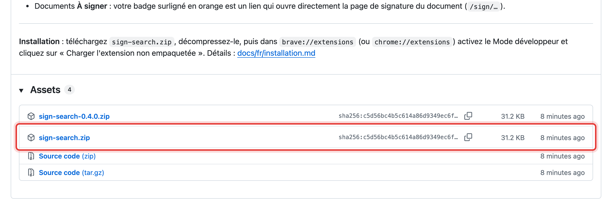
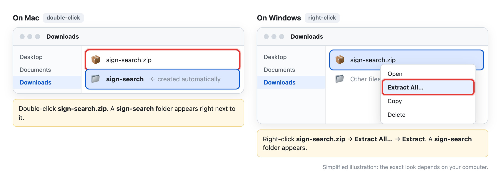
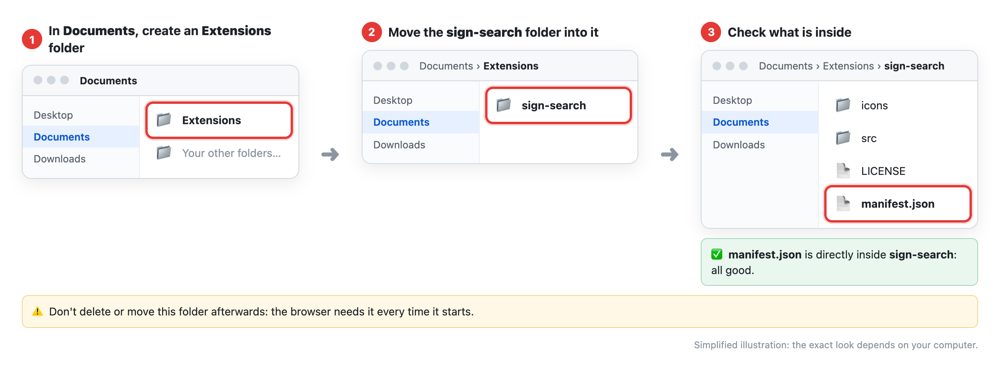
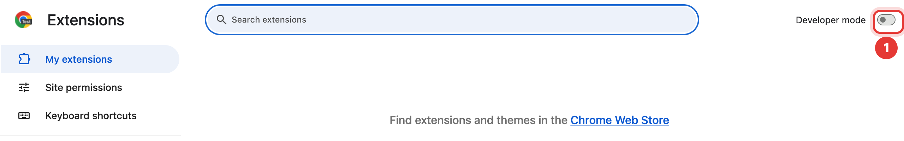
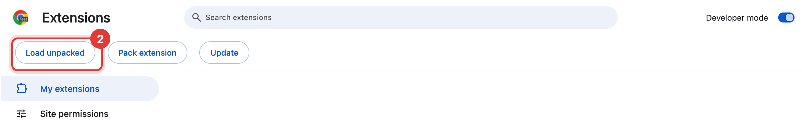
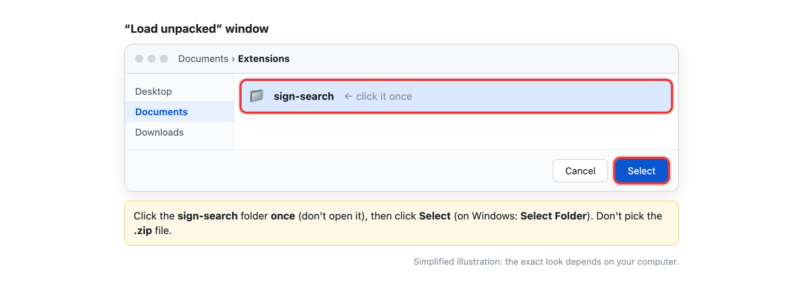
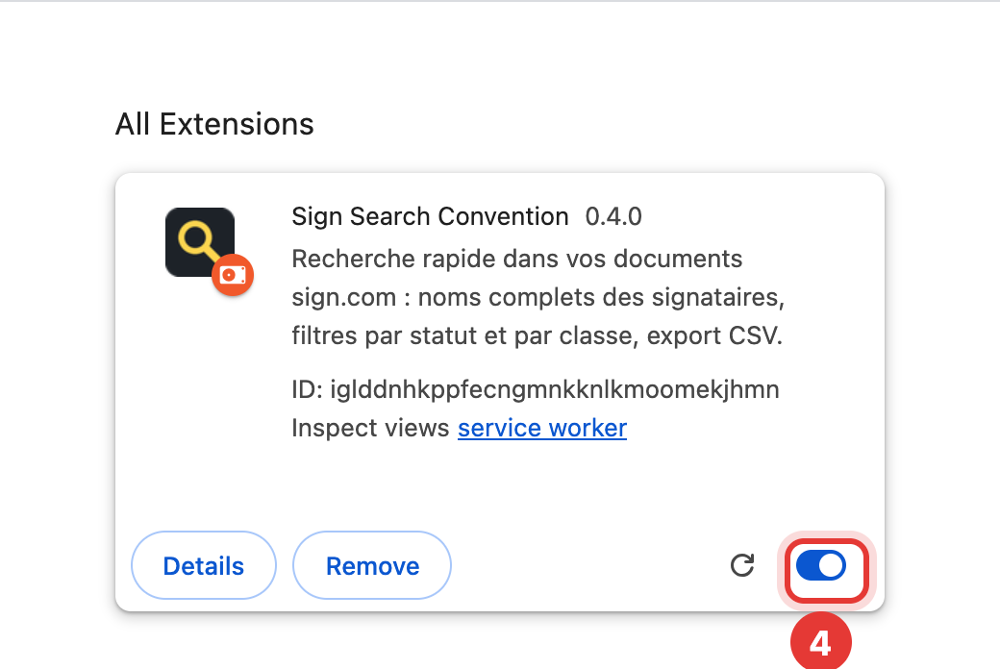
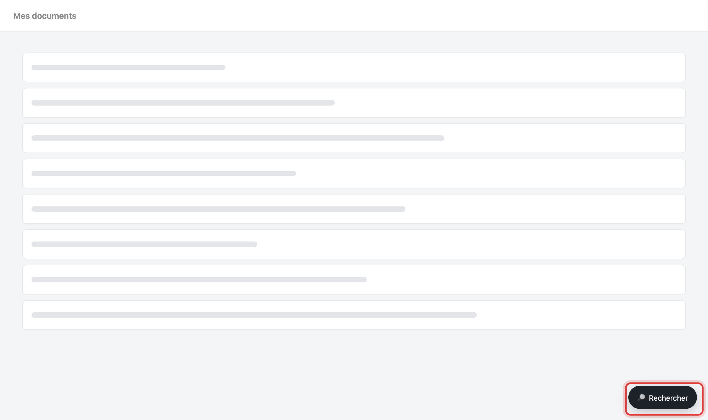
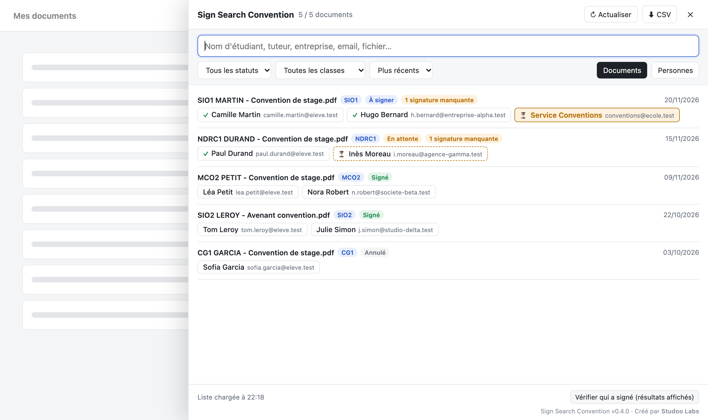

**English** · [Français](../fr/installation.md)

# Installation

The extension is not published on the Chrome Web Store. You install it by hand, in **developer mode**. Allow 5 minutes the first time. Follow the steps in order: each one is illustrated.

## Requirements

- A compatible browser: Chrome, Brave, Edge or another recent Chromium browser (see the [table below](#compatible-browsers)).
- A sign.com account signed in in that browser.

## Compatible browsers

The extension works in **Chromium**-based browsers (Manifest V3, version 88 or later).

| Browser | Compatible | Extensions page | Notes |
|---|---|---|---|
| Google Chrome | ✅ Yes | `chrome://extensions` | Reference browser. |
| Brave | ✅ Yes | `brave://extensions` | Reference browser. |
| Microsoft Edge | ✅ Yes | `edge://extensions` | **Developer mode** is in the left-hand menu. |
| Opera / Opera GX | ✅ Yes | `opera://extensions` | Chromium engine. |
| Vivaldi | ✅ Yes | `vivaldi://extensions` | Chromium engine. |
| Arc | ✅ Yes | `arc://extensions` | Chromium engine. |
| Firefox | ❌ No | — | Firefox does not accept the background *service worker* declared in the manifest. A Firefox version is listed as an [idea for later](development.md#ideas-for-later). |
| Safari | ❌ No | — | The extension would have to be converted with Xcode and distributed through Apple. |
| Mobile browsers (Android, iOS) | ❌ No | — | Chrome and Safari on mobile do not accept this kind of extension. |

Chrome and Brave are the reference browsers. The other Chromium browsers use the same engine and APIs, but are not tested for every release: if something goes wrong, open an issue on the repository.

## 1. Download the extension

1. Open the latest release page: https://github.com/studoo-app/sign-search/releases/latest
2. At the bottom of the page, under **Assets**, click **sign-search.zip**. The download starts on its own. You don't need a GitHub account.

   

   Direct link, if you prefer: [sign-search.zip](https://github.com/studoo-app/sign-search/releases/latest/download/sign-search.zip).

3. The file lands in your **Downloads** folder.

> Don't take **sign-search-0.4.0.zip** or **Source code**: they are not meant for this installation.

## 2. Unzip the file

A `.zip` file is a package that holds several files. You need to open it to take them out:

- **On Mac**: open your **Downloads** folder and double-click **sign-search.zip**.
- **On Windows**: open your **Downloads** folder, right-click **sign-search.zip**, choose **Extract All…**, then click **Extract**.

A **sign-search** folder appears next to the `.zip` file.

## 3. Put the folder in the right place

The browser reads this folder **every time it starts**. So put it somewhere you won't delete it by mistake (the Downloads folder often gets emptied). We recommend **Documents › Extensions**:

1. Open your **Documents** folder.
2. Create a new folder named **Extensions**:
   - on Mac: right-click in the window → **New Folder**;
   - on Windows: right-click in the window → **New** → **Folder**.
3. Drag the **sign-search** folder (from step 2) into **Extensions**.
4. Open **sign-search** to check: you should see **manifest.json**, **LICENSE**, **icons** and **src**.

If you see a **second sign-search folder** inside the first one instead of `manifest.json`, that second folder is the one to choose in step 4.

You can then delete **sign-search.zip** from Downloads: you no longer need it.

> **For developers**: `git clone https://github.com/studoo-app/sign-search.git` works too. The `sign-search.zip` archive is built by GitHub Actions for every version and contains only the extension (`manifest.json`, `LICENSE`, `src/`, `icons/`).

## 4. Install the extension in the browser

1. Open your browser, type `chrome://extensions` in the address bar (at the top of the window), then press **Enter**. With Brave, type `brave://extensions`. The addresses for other browsers are in the [compatible browsers table](#compatible-browsers).
2. At the top right, turn on the **Developer mode** toggle.

   

3. New buttons appear. Click **Load unpacked**.

   

4. A window opens to choose a folder. Go to **Documents › Extensions**, click the **sign-search** folder **once**, then click **Select** (on Windows: **Select Folder**). Don't pick the `.zip` file.

   

5. The **Sign Search Convention** card appears. Check that its toggle, at the bottom right of the card, is blue (on).

   

**Tip**: pin the icon to keep it handy. Click the puzzle piece 🧩 at the top right of the browser, then the pin 📌 next to "Sign Search Convention".

## 5. Check that everything works

1. Open (or reload) https://sign.com/storage/all-documents.
2. The **🔎 Rechercher** button appears at the bottom right.

   

3. Click it: the panel opens and shows "X / X documents".

   

> The screenshots were taken with a clean browser and made-up data. Steps 2 and 3, and the folder picker in step 4, are simplified illustrations: the exact look depends on your computer. The extension itself is in French.

## Update

Installed in developer mode, the extension **does not update itself**: you replace its files for each new version. It takes a minute, and you lose nothing, since the extension stores no data. Your keyboard shortcut is kept.

### Find out whether a new version exists

1. **Your version**: it is shown at the bottom of the panel ("Sign Search Convention v0.4.0") and on the extension's card on the extensions page.
2. **The latest published version**: it is on the repository's [Releases](https://github.com/studoo-app/sign-search/releases/latest) page, with the list of changes. The full history is in the [CHANGELOG](../../CHANGELOG.md) (in French).
3. **Get notified automatically** (optional): with a GitHub account, click **Watch → Custom → Releases** at the top of the [repository page](https://github.com/studoo-app/sign-search). GitHub then emails you for every new version.

### Install the new version

1. Download the latest archive: [sign-search.zip](https://github.com/studoo-app/sign-search/releases/latest/download/sign-search.zip).
2. Unzip it.
3. Open the folder where the extension is installed (the one chosen during installation, for example `Documents/Extensions/sign-search`). **Delete its contents**, then copy the archive's contents into it: `manifest.json`, `LICENSE`, `src/` and `icons/`. Deleting first avoids keeping old files that are no longer used.
4. Open the extensions page (`chrome://extensions`, `brave://extensions`… see the [browser table](#compatible-browsers)) and click the **↻** (Reload) icon on the "Sign Search Convention" card.
5. Reload any sign.com tabs that are already open: the old version stays active in them until they are reloaded.
6. Check the version number at the bottom of the panel.

**With Git**: in the extension's folder, run `git pull`, then follow steps 4 to 6.

### Pitfalls

- **Don't load the new version as a second extension.** If you unzip the archive somewhere else and click "Load unpacked", two copies run at the same time: two 🔎 buttons appear and the shortcut only opens one of them. If that happens, remove the old card on the extensions page.
- **Don't delete the folder itself**, only its contents. Otherwise the browser can no longer load the extension and shows an error on its card.
- **An extra subfolder**: when unzipping, macOS and Windows ("Extract All") create a `sign-search/` folder. Copy the files **it contains**, not the folder itself, so that `manifest.json` sits directly in the extension's folder.
- **The card shows "Errors" after ↻**: `manifest.json` is probably not at the right level. Check the previous point, then click ↻ again.

## Change the keyboard shortcut

The default shortcut is **Alt + Shift + S**. To change it, open `chrome://extensions/shortcuts` (or `brave://extensions/shortcuts`). Then find "Sign Search Convention" → "Ouvrir / fermer le panneau de recherche" (Open / close the search panel).

## Uninstall

On the extensions page, click **Remove** on the card. The extension stores no data, so there is nothing else to clean up.

## Why developer mode?

On Windows and macOS, Chrome only accepts a permanently installed extension, outside developer mode, if it comes from the **Chrome Web Store**. A `.crx` file dropped onto the extensions page is refused. Brave, being Chromium-based, follows the same rule.

There are two ways around it:

| Option | Pros | Cons |
|---|---|---|
| **Chrome Web Store, "Unlisted" visibility** | One-click install from a link, automatic updates. Also works in Brave. | Google developer account (one-time $5 fee), Google review for every version, privacy form to fill in |
| **Enterprise policy** (`ExtensionInstallForcelist`) | Forced deployment on the school's managed computers | Computers managed by GPO or MDM, signed `.crx` hosted with an `update.xml` file |

Until then, the zip published by GitHub Actions plus developer mode is the simplest option.

## "Disable developer mode extensions" message

Chrome sometimes shows this message at startup. Just close it with the cross, without disabling the extension. Brave doesn't show this message.
