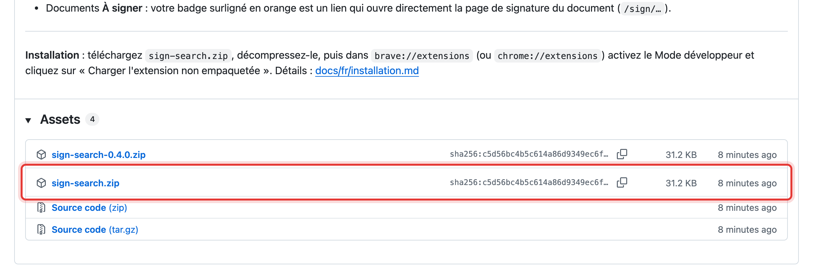
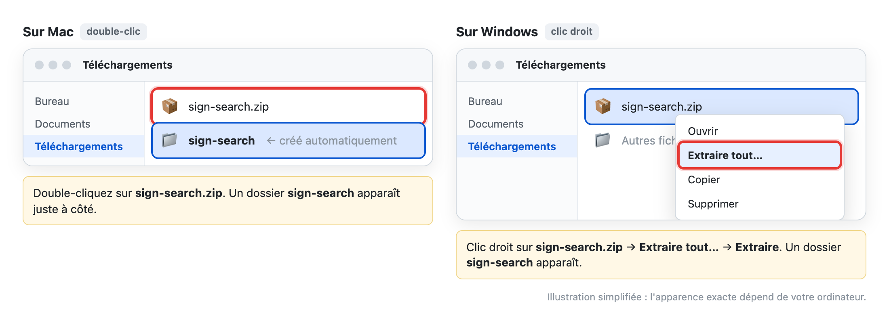
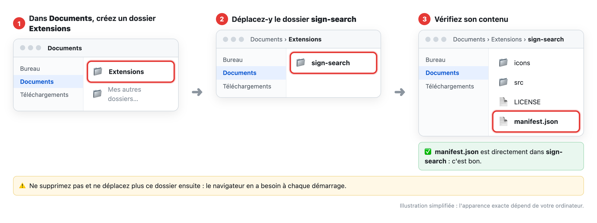
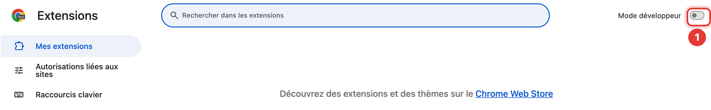
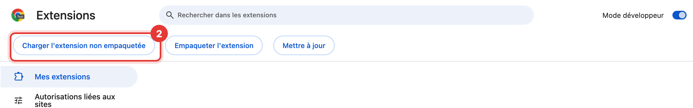
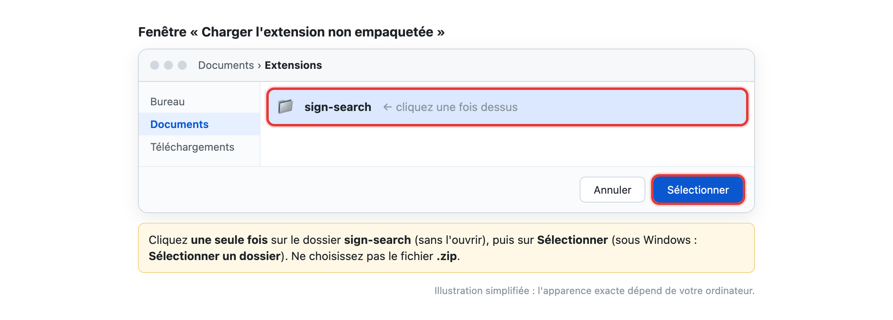
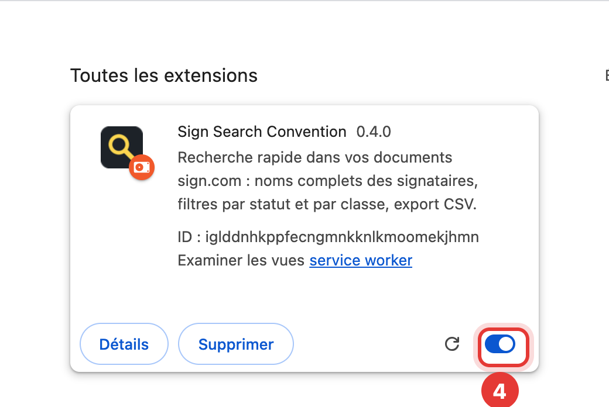
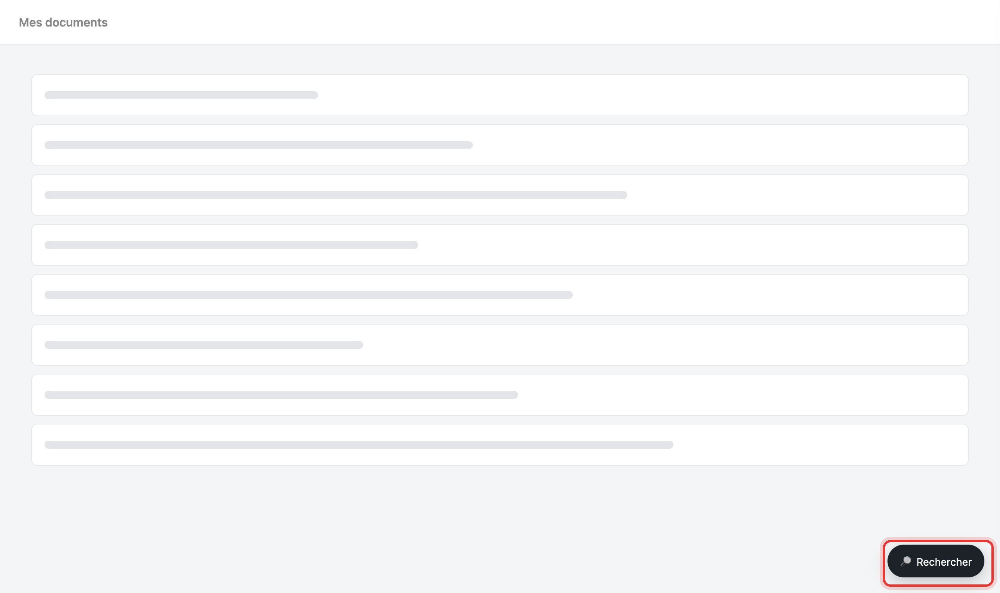
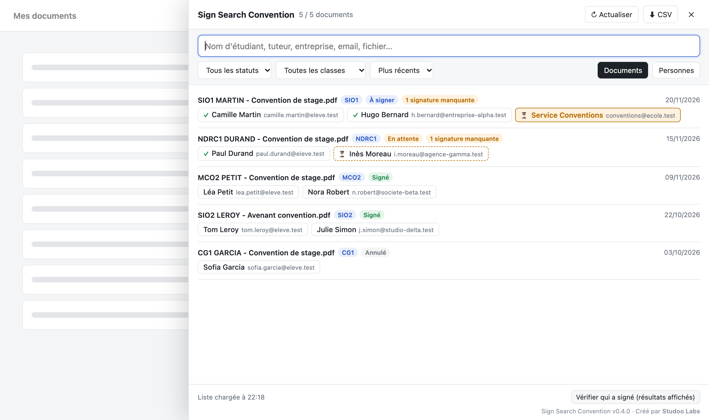

[English](../en/installation.md) · **Français**

# Installation

L'extension n'est pas publiée sur le Chrome Web Store. On l'installe à la main, en **mode développeur**. Comptez 5 minutes la première fois. Suivez les étapes dans l'ordre : chaque étape est illustrée.

## Prérequis

- Un navigateur compatible : Chrome, Brave, Edge ou un autre navigateur Chromium récent (voir le [tableau ci-dessous](#navigateurs-compatibles)).
- Un compte sign.com ouvert dans ce navigateur.

## Navigateurs compatibles

L'extension fonctionne dans les navigateurs basés sur **Chromium** (Manifest V3, version 88 ou plus).

| Navigateur | Compatible | Page des extensions | Remarques |
|---|---|---|---|
| Google Chrome | ✅ Oui | `chrome://extensions` | Navigateur de référence. |
| Brave | ✅ Oui | `brave://extensions` | Navigateur de référence. |
| Microsoft Edge | ✅ Oui | `edge://extensions` | Le **Mode développeur** se trouve dans le menu de gauche. |
| Opera / Opera GX | ✅ Oui | `opera://extensions` | Moteur Chromium. |
| Vivaldi | ✅ Oui | `vivaldi://extensions` | Moteur Chromium. |
| Arc | ✅ Oui | `arc://extensions` | Moteur Chromium. |
| Firefox | ❌ Non | — | Firefox n'accepte pas le *service worker* d'arrière-plan déclaré dans le manifest. Une version Firefox est une [piste d'évolution](developpement.md#pistes-dévolution). |
| Safari | ❌ Non | — | Il faudrait convertir l'extension avec Xcode et la distribuer par Apple. |
| Navigateurs mobiles (Android, iOS) | ❌ Non | — | Chrome et Safari sur mobile n'acceptent pas ce type d'extension. |

Chrome et Brave sont les navigateurs de référence. Les autres navigateurs Chromium utilisent le même moteur et les mêmes API, mais ne sont pas testés à chaque version : en cas de problème, ouvrez un ticket sur le dépôt.

## 1. Télécharger l'extension

1. Ouvrez la page de la dernière version : https://github.com/studoo-app/sign-search/releases/latest
2. En bas de la page, dans la partie **Assets**, cliquez sur **sign-search.zip**. Le téléchargement démarre tout seul. Il n'y a pas besoin de compte GitHub.

   

   Lien direct, si vous préférez : [sign-search.zip](https://github.com/studoo-app/sign-search/releases/latest/download/sign-search.zip).

3. Le fichier arrive dans votre dossier **Téléchargements**.

> Ne prenez pas **sign-search-0.4.0.zip** ni **Source code** : ils ne sont pas faits pour cette installation.

## 2. Décompresser le fichier

Un fichier `.zip` est un paquet qui contient plusieurs fichiers. Il faut l'ouvrir pour les sortir :

- **Sur Mac** : ouvrez le dossier **Téléchargements** et double-cliquez sur **sign-search.zip**.
- **Sur Windows** : ouvrez le dossier **Téléchargements**, faites un clic droit sur **sign-search.zip**, choisissez **Extraire tout…**, puis cliquez sur **Extraire**.

Un dossier **sign-search** apparaît à côté du fichier `.zip`.

## 3. Ranger le dossier au bon endroit

Le navigateur relit ce dossier **à chaque démarrage**. Il faut donc le mettre à un endroit où vous ne le supprimerez pas par erreur (le dossier Téléchargements est souvent vidé). Nous vous conseillons **Documents › Extensions** :

1. Ouvrez votre dossier **Documents**.
2. Créez un nouveau dossier nommé **Extensions** :
   - sur Mac : clic droit dans la fenêtre → **Nouveau dossier** ;
   - sur Windows : clic droit dans la fenêtre → **Nouveau** → **Dossier**.
3. Faites glisser le dossier **sign-search** (celui de l'étape 2) dans **Extensions**.
4. Ouvrez **sign-search** pour vérifier : vous devez voir **manifest.json**, **LICENSE**, **icons** et **src**.

Si vous voyez un **second dossier sign-search** à l'intérieur du premier, au lieu de `manifest.json`, c'est ce second dossier qu'il faudra choisir à l'étape 4.

Vous pouvez ensuite supprimer **sign-search.zip** des Téléchargements : il ne sert plus.

> **Pour les développeurs** : `git clone https://github.com/studoo-app/sign-search.git` fonctionne aussi. L'archive `sign-search.zip` est construite par GitHub Actions à chaque version et ne contient que l'extension (`manifest.json`, `LICENSE`, `src/`, `icons/`).

## 4. Installer l'extension dans le navigateur

1. Ouvrez votre navigateur, tapez `chrome://extensions` dans la barre d'adresse (en haut de la fenêtre), puis appuyez sur **Entrée**. Avec Brave, tapez `brave://extensions`. Les adresses des autres navigateurs sont dans le [tableau des navigateurs compatibles](#navigateurs-compatibles).
2. En haut à droite, activez l'interrupteur **Mode développeur**.

   

3. De nouveaux boutons apparaissent. Cliquez sur **Charger l'extension non empaquetée**.

   

4. Une fenêtre s'ouvre pour choisir un dossier. Allez dans **Documents › Extensions**, cliquez **une seule fois** sur le dossier **sign-search**, puis sur **Sélectionner** (sur Windows : **Sélectionner un dossier**). Ne choisissez pas le fichier `.zip`.

   

5. La carte **Sign Search Convention** apparaît. Vérifiez que son interrupteur, en bas à droite de la carte, est bien bleu (activé).

   

**Conseil** : épinglez l'icône pour la garder sous la main. Cliquez sur la pièce de puzzle 🧩 en haut à droite du navigateur, puis sur la punaise 📌 à côté de « Sign Search Convention ».

## 5. Vérifier que tout fonctionne

1. Ouvrez (ou rechargez) https://sign.com/storage/all-documents.
2. Le bouton **🔎 Rechercher** apparaît en bas à droite.

   

3. Cliquez dessus : le panneau s'ouvre et affiche « X / X documents ».

   

> Les captures sont faites avec un navigateur vierge et des données fictives. Les étapes 2, 3 et 4 (fenêtre de choix) sont des illustrations simplifiées : l'apparence exacte dépend de votre ordinateur.

## Mettre à jour

Installée en mode développeur, l'extension **ne se met pas à jour toute seule** : il faut remplacer ses fichiers à chaque nouvelle version. Cela prend une minute, et vous ne perdez rien, car l'extension n'enregistre aucune donnée. Votre raccourci clavier est conservé.

### Savoir si une nouvelle version existe

1. **Votre version** : elle est affichée en bas du panneau (« Sign Search Convention v0.4.0 ») et sur la carte de l'extension, dans la page des extensions.
2. **La dernière version publiée** : elle est sur la page [Releases](https://github.com/studoo-app/sign-search/releases/latest) du dépôt, avec la liste des nouveautés. L'historique complet est dans le [CHANGELOG](../../CHANGELOG.md).
3. **Être prévenu automatiquement** (facultatif) : avec un compte GitHub, cliquez sur **Watch → Custom → Releases** en haut de la [page du dépôt](https://github.com/studoo-app/sign-search). GitHub vous envoie alors un e-mail à chaque nouvelle version.

### Installer la nouvelle version

1. Téléchargez la dernière archive : [sign-search.zip](https://github.com/studoo-app/sign-search/releases/latest/download/sign-search.zip).
2. Décompressez-la.
3. Ouvrez le dossier où l'extension est installée (celui choisi à l'installation, par exemple `Documents/Extensions/sign-search`). **Supprimez son contenu**, puis copiez-y le contenu de l'archive : `manifest.json`, `LICENSE`, `src/` et `icons/`. Supprimer d'abord évite de garder d'anciens fichiers devenus inutiles.
4. Ouvrez la page des extensions (`chrome://extensions`, `brave://extensions`… voir le [tableau des navigateurs](#navigateurs-compatibles)) et cliquez sur l'icône **↻** (Actualiser) de la carte « Sign Search Convention ».
5. Rechargez les onglets sign.com déjà ouverts : l'ancienne version y reste active tant qu'ils ne sont pas rechargés.
6. Vérifiez le numéro de version en bas du panneau.

**Avec Git** : dans le dossier de l'extension, lancez `git pull`, puis faites les étapes 4 à 6.

### Pièges à éviter

- **Ne chargez pas la nouvelle version comme une deuxième extension.** Si vous décompressez l'archive ailleurs et cliquez sur « Charger l'extension non empaquetée », deux copies tournent en même temps : deux boutons 🔎 apparaissent et le raccourci n'en ouvre qu'une. Dans ce cas, supprimez l'ancienne carte dans la page des extensions.
- **Ne supprimez pas le dossier lui-même**, seulement son contenu. Sinon le navigateur ne peut plus charger l'extension et affiche une erreur sur sa carte.
- **Un sous-dossier en trop** : en décompressant, macOS et Windows (« Extraire tout ») créent un dossier `sign-search/`. Copiez les fichiers **qu'il contient**, et non le dossier lui-même, pour que `manifest.json` soit directement dans le dossier de l'extension.
- **La carte affiche « Erreurs » après ↻** : `manifest.json` n'est probablement pas au bon niveau. Vérifiez le point précédent, puis cliquez de nouveau sur ↻.

## Changer le raccourci clavier

Le raccourci par défaut est **Alt + Maj + S**. Pour le modifier, ouvrez `chrome://extensions/shortcuts` (ou `brave://extensions/shortcuts`). Cherchez ensuite « Sign Search Convention » → « Ouvrir / fermer le panneau de recherche ».

## Désinstaller

Dans la page des extensions, cliquez sur **Supprimer** sur la carte. L'extension n'enregistre aucune donnée : il n'y a rien d'autre à nettoyer.

## Pourquoi le mode développeur ?

Sur Windows et macOS, Chrome n'accepte une extension installée de façon permanente, sans mode développeur, que si elle vient du **Chrome Web Store**. Un fichier `.crx` glissé dans la page des extensions est refusé. Brave, basé sur Chromium, suit la même règle.

Pour s'en passer, il y a deux possibilités :

| Option | Avantages | Contraintes |
|---|---|---|
| **Chrome Web Store, publication « Non répertoriée »** | Installation en un clic depuis un lien, mises à jour automatiques. Fonctionne aussi dans Brave. | Compte développeur Google (frais uniques de 5 $), relecture par Google à chaque version, fiche de confidentialité à remplir |
| **Stratégie d'entreprise** (`ExtensionInstallForcelist`) | Déploiement imposé sur les postes gérés de l'établissement | Postes administrés par GPO ou MDM, `.crx` signé et hébergé avec un fichier `update.xml` |

En attendant, le zip publié par GitHub Actions et le mode développeur restent la solution la plus simple.

## Message « Désactiver les extensions en mode développeur »

Chrome affiche parfois ce message au démarrage. Cliquez simplement sur la croix pour le fermer, sans désactiver l'extension. Brave n'affiche pas ce message.
